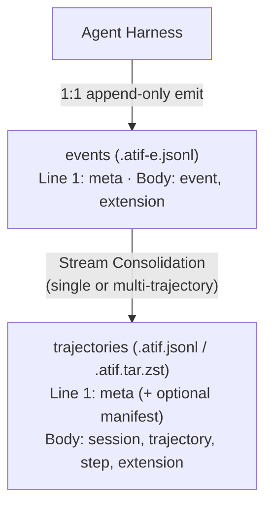
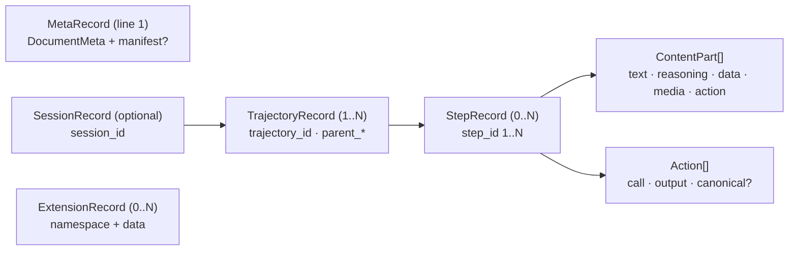
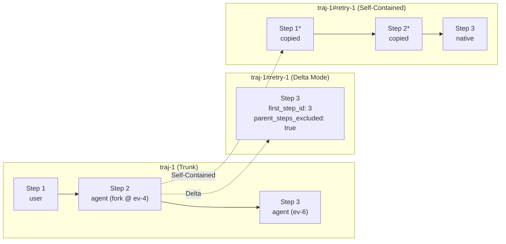
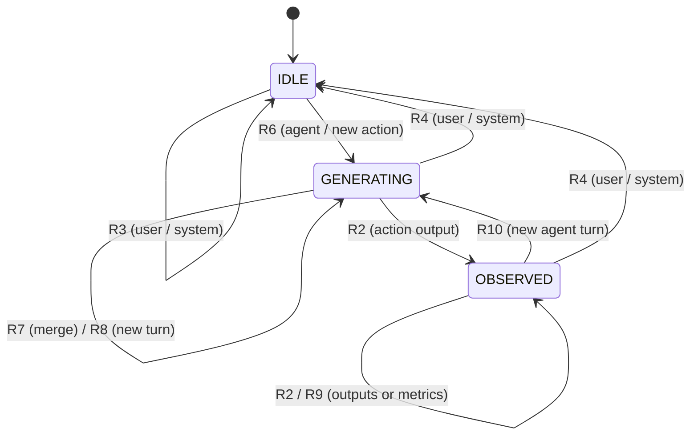

# Agent Trajectory Interchange Format (ATIF) v2.0 Specification

- **Schema Version**: `ATIF-v2.0`
- **Status**: Working Draft
- **Updated**: 2026-11-25
- **Supersedes**: [ATIF v1.8 Specification](../v1.8/SPEC.md)
- **Origin**: [Harbor RFC 0004 (PR #4134)](https://github.com/harbor-framework/harbor/pull/4134)
- **Companion Documents**:
  - [Canonical Actions Catalog](./references/canonical-actions.md) *(Normative)*
  - [Official Extension Namespaces](./references/extensions.md) *(Normative)*
  - [Wire (Protobuf) & Warehouse (SQL) Projections](./references/projections.md) *(Normative)*
  - [ATIF v1.x to v2.0 Migration](./references/v1-migration.md) *(Normative)*
  - [Translating Native Harness Formats](./references/harness-examples.md) *(Non-normative)*
- **Machine-Readable Schemas & Fixtures**:
  - JSON Schema 2020-12: [`atif-record.schema.json`](./schema/atif-record.schema.json), [`canonical-actions.schema.json`](./schema/canonical-actions.schema.json), [`common-defs.schema.json`](./schema/common-defs.schema.json)
  - Protocol Buffers: [`atif.proto`](./schema/atif.proto) · Warehouse SQL DDL: [`warehouse.sql`](./schema/warehouse.sql)
  - Reference Fixtures: [`session.atif-e.jsonl`](./examples/session.atif-e.jsonl) · [`session.atif.jsonl`](./examples/session.atif.jsonl)

---

## Overview

*This section is non-normative.*

The **Agent Trajectory Interchange Format (ATIF) v2.0** is a newline-delimited JSON (NDJSON) specification for recording autonomous AI agent runs across evaluation, observability, debugging, and training workflows. A single line envelope (`AtifRecord`) supports two document types: an append-only runtime stream (`events`) emitted while an agent runs, and a consolidated multi-trajectory document (`trajectories`) produced by a deterministic consolidation algorithm.

*(Upgrading from ATIF v1.0–v1.8? See [ATIF v1.x to v2.0 Migration](./references/v1-migration.md) and the [v2.0 Changelog](./CHANGELOG.md).)*

### Document Types

Line 1 of every ATIF v2.0 document is a `meta` record declaring `schema_version: "ATIF-v2.0"` and `document_type: "events" | "trajectories"`:



| `document_type` | File Extension | Body Record `type`s | Purpose |
| :--- | :--- | :--- | :--- |
| `"events"` | `.atif-e.jsonl` | `"event"`, `"extension"` | Append-only stream emitted 1:1 as native harness events occur; derived fields (`step_id`, `final_metrics`, union `type` discriminators) are omitted until consolidation. |
| `"trajectories"` | `.atif.jsonl`, `.atif.tar.zst` | `"session"`, `"trajectory"`, `"step"`, `"extension"` | Consolidated document holding one or more linear trajectories (roots, subagents, forks, candidates, rewinds) with an optional line-1 `meta.manifest` preview and optional `.atif.tar.zst` blob archive packaging. |

### Minimal Examples

**Minimal `events` document (`.atif-e.jsonl`):**

```jsonl
{"type":"meta","meta":{"schema_version":"ATIF-v2.0","document_type":"events","create_time":"2026-10-30T18:00:00Z"}}
{"type":"event","trajectory_id":"traj-1","event":{"event_id":"ev-0","timestamp":"2026-10-30T18:00:00Z","trajectory":{"agent":{"name":"my-agent","model":{"name":"claude-sonnet-4-5"}}}}}
{"type":"event","trajectory_id":"traj-1","event":{"event_id":"ev-1","timestamp":"2026-10-30T18:00:01Z","step":{"source":"user","content":[{"text":"Check git status."}]}}}
{"type":"event","trajectory_id":"traj-1","event":{"event_id":"ev-2","timestamp":"2026-10-30T18:00:02Z","step":{"source":"agent","content":[{"text":"Working tree is clean."}],"stop_reason":"completed"}}}
```

**Minimal `trajectories` document (`.atif.jsonl`):**

```jsonl
{"type":"meta","meta":{"schema_version":"ATIF-v2.0","document_type":"trajectories","create_time":"2026-10-30T18:00:03Z"}}
{"type":"trajectory","trajectory_id":"traj-1","trajectory":{"agent":{"name":"my-agent","model":{"name":"claude-sonnet-4-5"}},"status":"completed","step_count":2,"first_step_id":1}}
{"type":"step","trajectory_id":"traj-1","step":{"step_id":1,"event_ids":["ev-1"],"source":"user","content":[{"type":"text","text":"Check git status."}]}}
{"type":"step","trajectory_id":"traj-1","step":{"step_id":2,"event_ids":["ev-2"],"source":"agent","content":[{"type":"text","text":"Working tree is clean."}],"stop_reason":"completed"}}
```

### Reading Paths

| If you are building... | Read | Skip on first pass |
| :--- | :--- | :--- |
| **An event producer (harness / adapter)** | [Conventions](#conventions-and-conformance), [Wire Format](#wire-format-and-record-envelope), [Core Data Model](#core-data-model), [Metadata](#harness-environment-and-resource-metadata), [Metrics](#metrics-and-token-accounting), [Events Documents](#events-documents), [Canonical Actions](./references/canonical-actions.md), [Harness Examples](./references/harness-examples.md) | [Branching Modes](#branching-modes), [Stream Consolidation](#stream-consolidation-algorithm), [Archive Layout](#portable-archive-layout) |
| **A reader, viewer, or SQL analyst** | [Conventions](#conventions-and-conformance), [Wire Format](#wire-format-and-record-envelope), [Core Data Model](#core-data-model), [Metadata](#harness-environment-and-resource-metadata)–[Extensions](#extensions-model), [Trajectories Documents](#trajectories-documents-and-lineage), [Security](#security-considerations), [Projections](./references/projections.md) | [Events Documents](#events-documents), [Stream Consolidation](#stream-consolidation-algorithm) |
| **A consolidator or SDK** | All normative sections, [Appendix A](#appendix-a-end-to-end-consolidation-walkthrough), [Appendix B](#appendix-b-canonical-in-memory-sdk-model), and the conformance suite | [ATIF v1.x Migration](./references/v1-migration.md) |
| **A v1.x → v2.0 migrator** | [Conventions](#conventions-and-conformance), [Core Data Model](#core-data-model), [ATIF v1.x Migration](./references/v1-migration.md), [Official Extensions](./references/extensions.md) | [Events Documents](#events-documents), [Stream Consolidation](#stream-consolidation-algorithm) |

---

## Conventions and Conformance

### Requirement Keywords

The key words "MUST", "MUST NOT", "REQUIRED", "SHALL", "SHALL NOT", "SHOULD", "SHOULD NOT", "RECOMMENDED", "NOT RECOMMENDED", "MAY", and "OPTIONAL" in this document are to be interpreted as described in BCP 14 (RFC 2119, RFC 8174) when, and only when, they appear in all capitals.

Sections explicitly labeled *non-normative* and illustrative examples are informative.

### Conformance Roles

An implementation MAY conform to one or more of the following roles:

- **Event Producer**: Emits valid `"events"` documents (`.atif-e.jsonl`) conforming to [Wire Format](#wire-format-and-record-envelope), [Core Data Model](#core-data-model) (`events` columns), [Metrics](#metrics-and-token-accounting), and [Events Documents](#events-documents).
- **Trajectories Producer / Consolidator**: Emits valid `"trajectories"` documents (`.atif.jsonl` / `.atif.tar.zst`) conforming to all normative sections of this specification; consolidators MUST additionally implement the [Stream Consolidation Algorithm](#stream-consolidation-algorithm).
- **Reader**: Parses ATIF documents conforming to [Universal Reader Requirements](#universal-reader-requirements) and [Security Considerations](#security-considerations).

### Companion Documents and Schema Precedence

This document and its normative companion references ([Canonical Actions Catalog](./references/canonical-actions.md), [Official Extension Namespaces](./references/extensions.md), [Wire & Warehouse Projections](./references/projections.md), and [ATIF v1.x to v2.0 Migration](./references/v1-migration.md)) define the authoritative data model, behavioral invariants, and consolidation semantics. [Translating Native Harness Formats](./references/harness-examples.md) is non-normative.

The machine-readable schemas ([`atif-record.schema.json`](./schema/atif-record.schema.json), [`canonical-actions.schema.json`](./schema/canonical-actions.schema.json), [`common-defs.schema.json`](./schema/common-defs.schema.json), [`atif.proto`](./schema/atif.proto), and [`warehouse.sql`](./schema/warehouse.sql)) are co-maintained projections of this specification. Where a prose behavioral or cross-record invariant cannot be expressed in JSON Schema, Protobuf, or SQL alone, this specification governs.

### Notation and Terminology

- **Plain interface notation**: Type synopses use `?` for optional fields and `Record<string, T>` for string-keyed JSON objects.
- **Closed vs. open vocabularies**: A union without `| string` (such as `ActionExecutor`) is a **closed vocabulary**; a union ending in `| string` (such as `Trajectory.status` or `Step.stop_reason`) is an **open vocabulary** that accepts custom lowercase strings alongside the listed standard values.
- **Omission vs. `null`**: Optional JSON fields are omitted when absent. Where behavioral rules check for presence (e.g., "non-null" or `original_trajectory_id == null`), omitted fields and explicit `null` values are treated equivalently unless a schema rule specifies omission.
- **Derived fields**: Fields marked **derived** are computed during [Stream Consolidation](#stream-consolidation-algorithm) and omitted in `"events"` streams.

| Term | Meaning |
| :--- | :--- |
| **Record** | One top-level `AtifRecord` JSON object serialized on a single NDJSON line. |
| **Line** | Physical 1-based line position within an NDJSON file. |
| **Row** | A table row in the SQL warehouse projection. |
| **Trunk** | The surviving linear sequence of events for a `trajectory_id` obtained by walking predecessors backward from the final cursor `head` in Phase 1. |
| **Native step** | A `Step` executed directly in its owning trajectory (`original_trajectory_id` unset/`null`), as opposed to a step copied from an ancestor or merged candidate trajectory. |
| **Consolidate** | Run the three-phase [Stream Consolidation Algorithm](#stream-consolidation-algorithm) from `"events"` to `"trajectories"`. |
| **Merge** | Apply the [Field-Level Merge Rules](#field-level-merge-and-folding-rules) when combining multiple event payloads into one target struct. |

### Common Primitive Types

```ts
export type Timestamp = string;
export type Sha256Urn = `urn:sha256:${string}`;
export type ArdUrn = `urn:air:${string}` | string;
export type Modality = "text" | "image" | "audio" | "video" | "document" | string;
export type Extensions = Record<string, Record<string, unknown>>;
export type DocumentType = "events" | "trajectories";
export type AtifRecordType = "meta" | "event" | "session" | "trajectory" | "step" | "extension";
```

| Type | Format / Constraints |
| :--- | :--- |
| `Timestamp` | RFC 3339 UTC timestamp string (e.g., `"2026-10-30T18:00:00Z"`). |
| `Sha256Urn` | `"urn:sha256:<64-lowercase-hex>"` content digest. |
| `ArdUrn` | Optional Agentic Resource Discovery URN (`"urn:air:<publisher>:<namespace>:<name>"`; see [Resource Identifiers](#resource-identifiers)). |
| `Modality` | Open vocabulary; standard values: `"text"`, `"image"`, `"audio"`, `"video"`, `"document"`. |
| `Extensions` | Map keyed by reverse-DNS domain (e.g., `"com.anthropic.claude-code"`) or RFC 3986 URI, mapping to a JSON object payload. |
| `DocumentType` | Closed vocabulary: `"events"` or `"trajectories"`. |
| `AtifRecordType` | Closed vocabulary: `"meta"`, `"event"`, `"session"`, `"trajectory"`, `"step"`, or `"extension"`. |

---

## Wire Format and Record Envelope

### Record Envelope

Every line in an ATIF v2.0 NDJSON file is one of six `AtifRecord` variants discriminated by `type`:

```ts
export interface MetaRecord {
  type: "meta";
  meta: DocumentMeta;
}

export interface EventRecord {
  type: "event";
  session_id?: string;
  trajectory_id?: string;
  event: TrajectoryEvent;
}

export interface SessionRecord {
  type: "session";
  session_id: string;
  session: Session;
}

export interface TrajectoryRecord {
  type: "trajectory";
  session_id?: string;
  trajectory_id: string;
  trajectory: Trajectory;
}

export interface StepRecord {
  type: "step";
  session_id?: string;
  trajectory_id: string;
  step: Step;
}

export interface ExtensionRecord {
  type: "extension";
  session_id?: string;
  trajectory_id?: string;
  extension: ExtensionPayload;
}

export type AtifRecord =
  | MetaRecord
  | EventRecord
  | SessionRecord
  | TrajectoryRecord
  | StepRecord
  | ExtensionRecord;
```

**Envelope identifier rules:**

1. `trajectory_id` is required on `TrajectoryRecord`, `StepRecord`, and every `EventRecord` except those carrying `event.session` (which require `session_id` and omit `trajectory_id`).
2. `trajectory_id` MUST be unique per trajectory within a file and SHOULD be globally unique. On a root trajectory, `trajectory_id` MAY equal `session_id`.
3. `session_id` is an optional correlating identifier; standalone runs MAY omit `session_id` and `SessionRecord` lines.
4. Child trajectories sharing a `session_id` MUST use distinct `trajectory_id`s (for example, a native subagent ID or `"<root_id>#rewind-1"`).
5. On `StepRecord`, `session_id` (when present) MUST match the parent trajectory's `session_id`.
6. Envelope identifiers (`session_id`, `trajectory_id`) are authoritative on the wire.

### Document Header and Manifest

```ts
export interface DocumentMeta {
  schema_version: "ATIF-v2.0";
  document_type: DocumentType;
  create_time?: Timestamp;
  manifest?: DocumentManifest;
  extensions?: Extensions;
}

export interface DocumentManifest {
  sessions?: SessionRecord[];
  trajectories?: TrajectoryRecord[];
}
```

| Field | Type | Requirement | Description |
| :--- | :--- | :--- | :--- |
| `schema_version` | `"ATIF-v2.0"` | Required | Declares the ATIF wire version. |
| `document_type` | `DocumentType` | Required | `"events"` or `"trajectories"`. |
| `create_time` | `Timestamp` | Optional | RFC 3339 UTC timestamp when the document was written. |
| `manifest` | `DocumentManifest` | Optional (`trajectories` only) | Head-of-file directory preview of sessions and trajectories in this file. |
| `extensions` | `Extensions` | Optional | Document-level extension metadata. |

**`meta.manifest` preview rules:**

- Entries use the `SessionRecord` and `TrajectoryRecord` shapes with all inner `session` and `trajectory` fields optional (including `trajectory.agent`).
- Producers SHOULD include lightweight summary fields (`agent: { name, role, model: { name } }`, lineage fields, `title`, `status`, `step_count`, `first_step_id`, `start_time`, `end_time`, `final_metrics`, `tags`) and SHOULD omit large catalogs (`system_instructions`, `tools`, `skills`, `mcp_servers`, `subagents`).
- Body records remain authoritative during full hydration.

### Extension Payload

```ts
export interface ExtensionPayload {
  namespace: string;
  data: Record<string, unknown>;
}
```

`namespace` is a reverse-DNS domain (e.g., `"com.example.annotation"`) or RFC 3986 URI identifying the schema of `data`.

### Universal Reader Requirements

1. **Header dispatch**: Readers MUST dispatch on line 1 `meta.document_type`, never on filename extension alone. For mixed v1.x/v2.0 inputs, apply the 4-step format detection procedure in [ATIF v1.x to v2.0 Migration](./references/v1-migration.md#format-detection).
2. **Compression**: Readers SHOULD transparently decompress `.zst` and `.gz` wrappers.
3. **Line length floor**: Readers MUST support single NDJSON lines of **at least 16 MiB** (for large `agent.tools` catalogs).
4. **Forward compatibility**: Readers MUST ignore unknown fields on `DocumentMeta`, MUST skip records with unknown `type` values, and SHOULD accept any `ATIF-v2.x` minor version.
5. **Lenient `protojson` integer parsing**: Canonical ATIF JSON writers MUST emit integer fields (`step_id`, `input_tokens`, `size_bytes`, `original_bytes`, `seq`, etc.) as JSON numbers. Because standard Proto3 `protojson` encoders quote `int64` values as decimal strings (e.g., `"1200"`), readers SHOULD leniently accept decimal-string representations for integer fields.

---

## Core Data Model



### Session

A `Session` groups one or more related trajectories under a shared `session_id`:

```ts
export interface Session {
  title?: string;
  start_time?: Timestamp;
  end_time?: Timestamp;
  final_metrics?: FinalMetrics;
  tags?: string[];
  extensions?: Extensions;
}
```

| Field | Type | Origin | Description |
| :--- | :--- | :--- | :--- |
| `title` | `string` | Optional | Human-readable session title. |
| `start_time` | `Timestamp` | Derived | Earliest trajectory `start_time` in this file. |
| `end_time` | `Timestamp` | Derived | Latest trajectory `end_time` in this file. |
| `final_metrics` | `FinalMetrics` | Derived | Rollup across native steps (`original_trajectory_id == null`) in this file. |
| `tags` | `string[]` | Optional | Free-form session tags. |
| `extensions` | `Extensions` | Optional | Namespaced session metadata. |

### Trajectory

Every linear execution path—root run, subagent, fork, Best-of-N candidate, compaction run, or discarded rewind/retry—is represented as a `Trajectory`:

```ts
export type TrajectoryLineageReason =
  | "subagent"
  | "fork"
  | "rewind"
  | "retry"
  | "candidate"
  | "compaction"
  | "continuation"
  | "other"
  | string;

export interface Trajectory {
  parent_trajectory_id?: string;
  parent_reason?: TrajectoryLineageReason;
  parent_event_id?: string;
  parent_action_id?: string;
  parent_step_id?: number;
  parent_steps_excluded?: boolean;
  ancestor_trajectory_ids?: string[];
  child_trajectory_ids?: string[];
  trajectory_depth?: number;

  version?: string;
  title?: string;
  status?: "running" | "completed" | "failed" | "cancelled" | "max_steps" | "context_limit" | string;
  error?: string;
  start_time?: Timestamp;
  end_time?: Timestamp;

  agent?: AgentMetadata;
  environments?: EnvironmentDefinition[];
  step_count?: number;
  first_step_id?: number;
  final_metrics?: FinalMetrics;

  tags?: string[];
  notes?: string;
  truncated_fields?: Record<string, TruncationInfo>;
  extensions?: Extensions;
}
```

| Field | Type | Requirement / Origin | Description |
| :--- | :--- | :--- | :--- |
| `parent_trajectory_id` | `string` | Optional | Immediate parent `trajectory_id` for non-root trajectories. |
| `parent_reason` | `TrajectoryLineageReason` | Optional | Relationship to `parent_trajectory_id`. |
| `parent_event_id` | `string` | Optional | Event ID on the parent where this trajectory branched. |
| `parent_action_id` | `string` | Optional | Action ID on the parent that spawned this trajectory. |
| `parent_step_id` | `number` | Derived | 1-based `step_id` in `parent_trajectory_id` containing the branch/spawn point. |
| `parent_steps_excluded` | `boolean` | Optional | `true` in Delta Mode when unchanged shared prefix steps are omitted (see [Branching Modes](#branching-modes)). |
| `ancestor_trajectory_ids` | `string[]` | Derived | Transitive ancestry `[root_id, ..., parent_trajectory_id]`; `[]` on root trajectories. |
| `child_trajectory_ids` | `string[]` | Derived | Direct child `trajectory_id`s in chronological order. |
| `trajectory_depth` | `number` | Derived | 0-based tree depth (`0` on root trajectories). |
| `version` | `string` | Optional | Revision or etag when a trajectory record is updated over time. |
| `status` | `string` | Optional / Derived | Open vocabulary: `"running"`, `"completed"`, `"failed"`, `"cancelled"`, `"max_steps"`, `"context_limit"`. |
| `error` | `string` | Optional | Fatal trajectory-level error when `status` is `"failed"` or `"cancelled"`. |
| `start_time` | `Timestamp` | Derived | Earliest step `start_time` (or earliest event timestamp). |
| `end_time` | `Timestamp` | Derived | Latest step or action timestamp (falls back to event timestamp only when `step_count == 0`). |
| `agent` | `AgentMetadata` | Required on full `trajectory` body records; optional in `meta.manifest` | Agent harness and model configuration. |
| `environments` | `EnvironmentDefinition[]` | Optional | Runtime environments/sandboxes (`environments[0]` is default when `Action.environment_name` is omitted). |
| `step_count` | `number` | Derived | Count of serialized `StepRecord` lines for this trajectory. |
| `first_step_id` | `number` | Derived | Starting `step_id` (`1` by default; `K` or `K+1` in Delta Mode; omitted when `step_count == 0`). |
| `final_metrics` | `FinalMetrics` | Derived | Rollup across serialized `StepRecord` lines (and tool-internal `Action.metrics`). |
| `tags`, `notes` | `string[]`, `string` | Optional | Free-form labels and human/harness remarks. |
| `truncated_fields`, `extensions` | maps | Optional | Local truncation metadata and namespaced extensions. |

**`TrajectoryLineageReason` standard values (open vocabulary):**

| Value | Meaning |
| :--- | :--- |
| `"subagent"` | Delegated subagent (fresh context or context-forked prefix). |
| `"fork"` | User- or harness-initiated session fork. |
| `"rewind"` | Discarded multi-step or user-initiated backtrack/rewind branch. |
| `"retry"` | Discarded single-step agent generation retry/regeneration branch. |
| `"candidate"` | Best-of-N candidate arm (fan-out or winner merge-back). |
| `"compaction"` | Captured trajectory invoked specifically to summarize/compact context. |
| `"continuation"` | Context rollover continuation from a prior trajectory. |
| `"other"` | Any other parent-child trajectory relationship. |

### Step

Each `Step` represents one logical turn: a `user` message, a `system` instruction or compaction event, or a single `agent` LLM inference call together with the actions it invoked.

```ts
export interface Step {
  step_id?: number;
  event_ids?: string[];
  original_trajectory_id?: string;
  original_trajectory_reason?: TrajectoryLineageReason;

  source: "system" | "user" | "agent";
  agent_name?: string;
  start_time?: Timestamp;
  end_time?: Timestamp;
  model?: ModelMetadata;
  compaction?: CompactionInfo;

  content?: ContentPart[];
  actions?: Action[];
  citations?: Citation[];

  error?: string;
  stop_reason?: "completed" | "tools" | "cancelled" | "max_tokens" | "timed_out" | "errored" | "refused" | string;

  metrics?: StepMetrics;
  truncated_fields?: Record<string, TruncationInfo>;
  extensions?: Extensions;
}
```

| Field | Type | `events` | `trajectories` | Description |
| :--- | :--- | :--- | :--- | :--- |
| `step_id` | `number` | Omitted | Required, derived | 1-based step index within the trajectory. |
| `event_ids` | `string[]` | Omitted | Optional, derived | Ordered `event_id`s folded into this step (`event_ids[0]` is primary). |
| `original_trajectory_id` | `string` | Omitted | Optional, derived | Source `trajectory_id` when copied (or `"(unknown)"` when origin ID is unavailable). |
| `original_trajectory_reason` | `TrajectoryLineageReason` | Omitted | Optional, derived | Reason this step was copied from `original_trajectory_id`. |
| `source` | `"system"` \| `"user"` \| `"agent"` | Required | Required | Closed vocabulary identifying who produced the step. |
| `agent_name` | `string` | Optional | Optional | Step-level override when different from `Trajectory.agent.name` (matches `agent.subagents[].name`). |
| `start_time`, `end_time` | `Timestamp` | Optional | Optional / Derived | Turn start and end timestamps. |
| `model` | `ModelMetadata` | Optional | Optional | Step-level model override when different from `Trajectory.agent.model`. |
| `compaction` | `CompactionInfo` | Optional | Optional | Context compaction metadata when this step compacts, truncates, or injects context. |
| `content` | `ContentPart[]` | Optional | Optional | Interleaved multimodal blocks and `{ type: "action", action_id }` invocation markers in exact generation order. |
| `actions` | `Action[]` | Optional | Optional | Actions executed during this step. |
| `citations` | `Citation[]` | Optional | Optional | Cited sources or grounding references returned for this step. |
| `error` | `string` | Optional | Optional | Error description when the step itself failed (`stop_reason: "errored"`). |
| `stop_reason` | `string` | Optional | Optional | Open vocabulary: `"completed"`, `"tools"`, `"cancelled"`, `"max_tokens"`, `"timed_out"`, `"errored"`, `"refused"`. |
| `metrics` | `StepMetrics` | Optional | Optional | Token, cost, latency, and RL token-ID metrics for this step. |
| `truncated_fields`, `extensions` | maps | Optional | Optional | Local truncation metadata and namespaced extensions. |

**Copied step accounting:**

- Provenance is tracked at `Step` granularity. Native steps omit `original_trajectory_id`.
- Copied prefix or merged candidate steps retain their `metrics` (included in `Trajectory.final_metrics`), while `Session.final_metrics` and SFT/RL consumers filter on `original_trajectory_id == null`.
- On a mid-step fork, attributing the re-emitted Step `K` to the trajectory that opened it (`original_trajectory_id: "<parent_id>"`) counts the pre-fork LLM inference once in `Session.final_metrics`, while any new branch generation opens a native Step `K+1` (see [Phase 2 rules `R8`/`R10`](#phase-2-turn-state-machine-and-event-folding)).

### Multimodal Content and Citations

```ts
export type ContentPartType =
  | "text" | "reasoning" | "data" | "image" | "audio" | "video" | "document" | "action";

export interface ContentPart {
  type?: ContentPartType;
  text?: string;
  reasoning?: ReasoningContent;
  data?: Record<string, unknown>;
  source?: MediaSource;
  action_id?: string;
  truncated_fields?: Record<string, TruncationInfo>;
  extensions?: Extensions;
}

export interface ReasoningContent {
  text?: string;
  summarized?: boolean;
  signature?: string;
}

export interface MediaSource extends BlobReference {
  duration_sec?: number;
}

export interface Citation {
  uri?: string;
  title?: string;
  cited_text?: string;
  extensions?: Extensions;
}
```

**`ContentPart` union & discriminator rules:**

- Exactly one payload field (`text`, `reasoning`, `data`, `source`, or `action_id`) MUST be populated on each `ContentPart`, matching `type`:
  - `"text"` → `text`
  - `"reasoning"` → `reasoning` (`text` is verbatim CoT or a summary when `summarized: true`, and is omitted when provider-redacted; `signature` holds a verification signature or encrypted payload)
  - `"data"` → `data` (structured JSON object)
  - `"image"`, `"audio"`, `"video"`, `"document"` → `source` (`MediaSource`, extending `BlobReference` with optional `duration_sec` for audio/video)
  - `"action"` → `action_id` (interleaved invocation marker referencing an `Action` in `Step.actions[]`)
- `ContentPart` maps 1:1 to a Proto3 `oneof` (`text | reasoning | data | source | action_id`).
- `ContentPart.type` is optional in `"events"` documents (inferred from the populated key or `source.media_type` prefix `image/*`, `audio/*`, `video/*`, or `"document"` otherwise) and MUST be populated in `"trajectories"` documents and SQL projections.
- `Citation.uri` is an RFC 3986 URI (web URL, file URI, or document URI); `title`, `cited_text`, and provider-specific `extensions` (such as span offsets, PDF pages, or confidence scores) are optional.

### Context Compaction

When an agent or harness compacts, truncates, or injects context mid-trajectory, it records a `Step` with `compaction: CompactionInfo` (plus `metrics` if an LLM call generated the summary):

```ts
export interface CompactionInfo {
  trigger?: "limit" | "manual" | "agent" | "subagent_handoff" | "pruning" | "injection" | string;
  boundary?: "replace" | "truncate" | "append" | string;
  event_id_start?: string;
  event_id_end?: string;
  step_id_start?: number;
  step_id_end?: number;
  summary?: string;
  tokens_before?: number;
  tokens_after?: number;
  compaction_trajectory_id?: string;
  extensions?: Extensions;
}
```

| Field | Type | Origin | Description |
| :--- | :--- | :--- | :--- |
| `trigger` | `string` | Optional | Open vocabulary: `"limit"`, `"manual"`, `"agent"`, `"subagent_handoff"`, `"pruning"`, `"injection"`. |
| `boundary` | `string` | Optional | Open vocabulary: `"replace"`, `"truncate"`, `"append"` (see semantics below). |
| `event_id_start`, `event_id_end` | `string` | Optional | First and last `event_id` in the compacted range. |
| `step_id_start`, `step_id_end` | `number` | Derived | 1-based start and end `step_id` resolved from `event_id_start`/`event_id_end`. |
| `summary` | `string` | Optional | Summary or handoff prompt replacing compacted history. |
| `tokens_before`, `tokens_after` | `number` | Optional | Context token counts before and after compaction. |
| `compaction_trajectory_id` | `string` | Optional | Child `trajectory_id` when compaction ran as `parent_reason: "compaction"`. |
| `extensions` | `Extensions` | Optional | Namespaced compaction metadata. |

**`boundary` semantics:**

| Value | Meaning |
| :--- | :--- |
| `"replace"` | Active post-compaction model context begins with `summary` in place of `step_id_start..step_id_end`. |
| `"truncate"` | Drops `step_id_start..step_id_end` without a summary. |
| `"append"` | Injects `summary` without evicting prior steps. |

### Actions and Approvals

`Step.actions` colocates each tool or environment action's invocation, result, timing, error status, approval, background task correlation, and semantic normalization:

```ts
export type ActionExecutor = "client" | "environment" | "provider" | "external";

export interface Action {
  action_id: string;
  event_ids?: string[];
  type?: "tool" | "system" | "user_interaction" | "policy" | "internal" | string;
  parent_action_id?: string;

  executor?: ActionExecutor;
  environment_name?: string;

  task_id?: string;
  task_detached?: boolean;
  errored?: boolean;

  name?: string;
  uri?: ArdUrn | string;
  arguments?: Record<string, unknown>;
  approval?: ApprovalInfo;
  output?: ContentPart[];
  canonical?: CanonicalAction;

  model?: ModelMetadata;
  metrics?: StepMetrics;
  start_time?: Timestamp;
  end_time?: Timestamp;
  truncated_fields?: Record<string, TruncationInfo>;
  extensions?: Extensions;
}

export interface ApprovalInfo {
  decision: "approved" | "rejected" | "timeout";
  authority: "user" | "agent" | "policy";
  reason?: string;
  reviewer?: string;
  decision_time?: Timestamp;
  extensions?: Extensions;
}
```

| Field | Type | `events` | `trajectories` | Description |
| :--- | :--- | :--- | :--- | :--- |
| `action_id` | `string` | Required | Required | Unique identifier within `trajectory_id`. |
| `event_ids` | `string[]` | Omitted | Optional, derived | Ordered `event_id`s contributing to this action. |
| `type` | `string` | Optional | Optional | Open vocabulary: `"tool"`, `"system"`, `"user_interaction"`, `"policy"`, `"internal"`. Non-tool environment observations use `"internal"` or `"system"`. |
| `parent_action_id` | `string` | Optional | Optional | Enclosing `action_id` for nested, code-mode, or `canonical.multi` sub-actions. |
| `executor` | `ActionExecutor` | Optional | Optional | Closed execution-plane vocabulary (defaults to matching `ToolDefinition.executor`). |
| `environment_name` | `string` | Optional | Optional | Target `EnvironmentDefinition.name` in `Trajectory.environments[]` (defaults to `environments[0]`). |
| `task_id` | `string` | Optional | Optional | Correlates background launch, status-poll, send-input, and completion actions. |
| `task_detached` | `boolean` | Optional | Optional | `true` when spawning a background task that outlives this step. |
| `errored` | `boolean` | Optional | Optional | `true` on tool error or non-zero exit status (sticky during merge). |
| `name` | `string` | Optional on output updates | Required | Raw tool or action name emitted by the harness. |
| `uri` | `ArdUrn` \| `string` | Optional | Optional | ARD URN or tool URI (see [Resource Identifiers](#resource-identifiers)). |
| `arguments` | `Record<string, unknown>` | Optional | Optional | Raw tool call arguments. |
| `approval` | `ApprovalInfo` | Optional | Optional | Human, agent, or policy approval decision (`decision` and `authority` are closed vocabularies). |
| `output` | `ContentPart[]` | Optional | Optional | Multimodal action result parts. |
| `canonical` | `CanonicalAction` | Optional | Optional | Harness-agnostic semantic overlay (see [Canonical Actions Catalog](./references/canonical-actions.md)). |
| `model`, `metrics` | structs | Optional | Optional | Populated when the action itself performs an internal LLM call. |
| `start_time`, `end_time` | `Timestamp` | Optional | Optional / Derived | Action start and end timestamps. |
| `truncated_fields`, `extensions` | maps | Optional | Optional | Local truncation metadata and namespaced extensions. |

**Action invariants:**

1. **Trajectory-unique `action_id`**: `Action.action_id` MUST be unique within a `trajectory_id` across both `"events"` and `"trajectories"` documents. If an underlying model or harness reuses per-turn call IDs (e.g., `"call_1"` across turns), the `"events"` producer MUST scope the ID to the turn or event (e.g., `"<turn>-call_1"`).
2. **Detached background tasks**: An action with `task_detached: true` closes immediately with its synchronous launch output and MUST NOT mutate past steps. Later status polls (`task_status`), input sends, or completion notifications are recorded as separate `Action` entries on the step where they occur, correlated via `task_id`.
3. **Execution plane (`executor`) and environment targeting (`environment_name`)**: `ActionExecutor` is a closed 4-value vocabulary distinguishing *where* execution occurred:

| `executor` | Execution Plane | Examples |
| :--- | :--- | :--- |
| `"client"` | Agent client or orchestrator process | Subagent/swarm coordination, credential-proxied controller tools |
| `"environment"` | Runtime workspace or sandbox in `Trajectory.environments[]` | Shell, filesystem, container actions |
| `"provider"` | Server-side inside the LLM API or inference router | Anthropic `server_tool_use`, OpenAI/Gemini built-in tools, router plugins |
| `"external"` | External service or remote tool host | MCP servers, remote agent APIs |

`ToolDefinition.executor` declares a tool's default execution plane; `Action.executor` overrides it or stands alone when `agent.tools` is omitted. `Action.environment_name` identifies which `EnvironmentDefinition.name` hosted or was targeted by the action (defaulting to `Trajectory.environments[0]` when omitted) and is orthogonal to `executor` (for example, an `"external"` local `stdio` MCP server inside a sandbox MAY still record its `environment_name`).

### Canonical Actions Overview

While `Action.name`, `Action.arguments`, and `Action.output` always preserve the raw harness call, `Action.canonical` provides an optional strongly typed semantic overlay for cross-harness analysis. Top-level `Action.canonical.mcp` records MCP server/tool provenance orthogonally so MCP-backed tools can simultaneously populate a semantic variant (`file_read`, `search`, etc.). In `"trajectories"` documents and SQL projections, `Action.canonical.type` holds the active variant key (or `"mcp_tool"` when only `canonical.mcp` is populated).

| Semantic Family | `CanonicalAction` Variants |
| :--- | :--- |
| **Utility** | `multi` |
| **Agent Coordination & Lifecycle** | `subagent`, `message_send`, `message_read`, `elicitation`, `timer`, `synthetic_context` |
| **Task & Process Management** | `task_status`, `task_list`, `task_stop` |
| **Command & Script Execution** | `shell_command`, `shell_send_input`, `script_exec` |
| **Filesystem Operations** | `file_read`, `file_write`, `file_search`, `file_list`, `file_move`, `file_delete` |
| **Information Retrieval & Web** | `search`, `web_fetch` |
| **Skills** | `skill_activate`, `skill_reference`, `skill_script` |
| **Media Generation** | `generate_media` |
| **Extensibility, Discovery, & MCP** | `extension`, `resource_discovery`, plus orthogonal `canonical.mcp` (`type: "mcp_tool"` when standalone) |

The normative definitions of all 28 `CanonicalActionType` values and their schemas are specified in the **[Canonical Actions Catalog](./references/canonical-actions.md)**.

---

## Harness, Environment, and Resource Metadata

### Agent Metadata

```ts
export interface AgentMetadata {
  name: string;
  version?: string;
  role?: string;
  identifier?: ArdUrn | string;
  model?: ModelMetadata;
  system_instructions?: string;
  skills?: SkillDefinition[];
  mcp_servers?: McpServerDefinition[];
  subagents?: SubagentDefinition[];
  tools?: ToolDefinition[];
  truncated_fields?: Record<string, TruncationInfo>;
  extensions?: Extensions;
}
```

- `name` is required (e.g., `"claude-code"`, `"codex-cli"`, `"terminus-2"`).
- `role` records the agent's multi-agent role (e.g., `"coordinator"`, `"reviewer"`).
- `system_instructions` retains an inline preview when truncated (recorded in `AgentMetadata.truncated_fields["system_instructions"]`).

### Model Metadata

```ts
export interface ModelMetadata {
  name?: string;
  provider?: string;
  version?: string;
  reasoning_effort?: "none" | "minimal" | "low" | "medium" | "high" | "xhigh" | "max" | string;
  reasoning_budget?: number;
  context_window_tokens?: number;
  supported_modalities?: Modality[];
  parameters?: Record<string, unknown>;
  identifier?: ArdUrn | string;
  extensions?: Extensions;
}
```

- `reasoning_effort` captures qualitative effort tiers (open vocabulary); `reasoning_budget` captures numeric thinking token budgets or ratios.
- `parameters` holds inference parameters such as `temperature`, `top_p`, and `max_output_tokens`.

### Tool Definitions

Provider-neutral tool schema aligned with the Model Context Protocol (MCP) `Tool` shape (`snake_case`):

```ts
export interface ToolDefinition {
  name: string;
  title?: string;
  description?: string;
  input_schema?: Record<string, unknown>;
  output_schema?: Record<string, unknown>;
  annotations?: Record<string, unknown>;
  executor?: ActionExecutor;
  mcp_server?: string;
  identifier?: ArdUrn | string;
  extensions?: Extensions;
}
```

- `name` matches `Action.name`; `input_schema` and `output_schema` hold JSON Schemas.
- `annotations` carries MCP tool hints (`read_only_hint`, `destructive_hint`, `idempotent_hint`, `open_world_hint`).
- `executor` declares the default execution plane for calls to this tool (`Action.executor` may override); `mcp_server` references the originating `McpServerDefinition.name`.

### Auxiliary Catalogs

#### `SkillDefinition`

```ts
export interface SkillDefinition {
  name: string;
  description?: string;
  version?: string;
  uri?: string;
  identifier?: ArdUrn | string;
  type?: string;
  source?: BlobReference;
  extensions?: Extensions;
}
```

`uri` points to the skill definition (e.g., `SKILL.md`); `source` optionally references an archived skill bundle/file.

#### `McpServerDefinition`

```ts
export interface McpServerDefinition {
  name: string;
  transport?: "stdio" | "sse" | "streamable_http" | "in_process" | string;
  uri?: string;
  command?: string;
  args?: string[];
  version?: string;
  identifier?: ArdUrn | string;
  tools?: string[];
  extensions?: Extensions;
}
```

`tools` lists the tool names exposed by this MCP server.

#### `SubagentDefinition`

```ts
export interface SubagentDefinition {
  name: string;
  description?: string;
  model_name?: string;
  system_instructions?: string;
  allowed_tools?: string[];
  identifier?: ArdUrn | string;
  truncated_fields?: Record<string, TruncationInfo>;
  extensions?: Extensions;
}
```

### Execution Environments

```ts
export interface SandboxConfig {
  type?: string;
  image?: string;
  network_restricted?: boolean;
  filesystem_restricted?: boolean;
  writable_roots?: string[];
  approval_mode?: string;
  extensions?: Extensions;
}

export interface VcsInfo {
  system?: "git" | "jj" | "hg" | "perforce" | "other" | string;
  repo_uri?: string;
  root_dir?: string;
  branch?: string;
  commit?: string;
  dirty?: boolean;
  diff?: BlobReference;
  extensions?: Extensions;
}

export interface EnvironmentDefinition {
  name?: string;
  os?: string;
  os_version?: string;
  arch?: string;
  cwd?: string;
  shell?: string;
  identifier?: ArdUrn | string;
  sandbox?: SandboxConfig;
  vcs?: VcsInfo;
  extensions?: Extensions;
}
```

- `name` is the local key referenced by `Action.environment_name`. It is optional when `Trajectory.environments[]` has a single entry and REQUIRED on every entry when `environments.length > 1`.
- `sandbox.type` identifies the isolation runtime (e.g., `"docker"`, `"seatbelt"`, `"landlock"`, `"daytona"`, `"modal"`); `sandbox.approval_mode` records policy mode (e.g., `"on-request"`, `"never"`, `"auto-edit"`).
- `vcs.diff` optionally references an uncommitted working-tree diff patch blob.

### Resource Identifiers

Every catalog entity (`AgentMetadata`, `ModelMetadata`, `ToolDefinition`, `EnvironmentDefinition`, `SkillDefinition`, `McpServerDefinition`, and `SubagentDefinition`), `Action.uri`, and `identifier` / `*_identifier` fields in the [Canonical Actions Catalog](./references/canonical-actions.md) accept an optional `identifier?: ArdUrn | string`.

When populated, `identifier` SHOULD use the 5-segment **Agentic Resource Discovery (ARD)** URN format defined by the [AI Catalog specification][ai-catalog]:

```text
urn:air:<publisher>:<namespace>:<name>
```

Standard namespaces are `runtimes`, `agents`, `models`, `tools`, `skills`, `mcp`, and `environments` (for example, `urn:air:anthropic:models:claude-sonnet-4-5`, `urn:air:github:mcp:github-mcp-server`, or `urn:air:harbor:skills:pytest-debugging`).

---

## Metrics and Token Accounting

### Inclusive Token Accounting

All token counts in `StepMetrics`, `FinalMetrics`, and `GranularTokenUsage` MUST satisfy the **Inclusive Token Accounting Invariant**:

```text
input_tokens  >= (cache_read_tokens ?? 0) + (cache_write_tokens ?? 0)
output_tokens >= (reasoning_tokens ?? 0)
```

- `input_tokens` is total input/prompt tokens, **inclusive** of `cache_read_tokens` and `cache_write_tokens`.
- `output_tokens` is total output/completion tokens, **inclusive** of `reasoning_tokens`.

### Cross-Provider Token Normalization

Producers converting native LLM or harness usage payloads MUST normalize them to the inclusive invariant using the formulas below:

| Provider / Harness | Native Token Fields | ATIF v2.0 `StepMetrics` Formula |
| :--- | :--- | :--- |
| **Anthropic API** (Claude Code, Pi, Cursor CLI, Cline) | `input_tokens` (uncached only), `cache_read_input_tokens`, `cache_creation_input_tokens`, `output_tokens` | `input_tokens = raw.input_tokens + cache_read + cache_creation`<br>`cache_read_tokens = cache_read`<br>`cache_write_tokens = cache_creation`<br>`output_tokens = raw.output_tokens` |
| **OpenAI Responses / Chat API** (Codex CLI, Mini-SWE-Agent) | `input_tokens` (inclusive), `cached_input_tokens`, `output_tokens` (inclusive), `reasoning_output_tokens` | `input_tokens = raw.input_tokens`<br>`cache_read_tokens = raw.cached_input_tokens`<br>`output_tokens = raw.output_tokens`<br>`reasoning_tokens = raw.reasoning_output_tokens` |
| **Google Gemini API** (Antigravity, ADK) | `promptTokenCount` (inclusive of cached), `toolUsePromptTokenCount`, `candidatesTokenCount` (excludes thoughts), `thoughtsTokenCount` | `input_tokens = promptTokenCount + (toolUsePromptTokenCount ?? 0)`<br>`cache_read_tokens = cachedContentTokenCount`<br>`output_tokens = candidatesTokenCount + (thoughtsTokenCount ?? 0)`<br>`reasoning_tokens = thoughtsTokenCount` |
| **OpenCode** | `tokens: { input, output, reasoning, cache: { read, write } }` (disjoint buckets) | `input_tokens = tokens.input + (cache.read ?? 0) + (cache.write ?? 0)`<br>`cache_read_tokens = cache.read`; `cache_write_tokens = cache.write`<br>`output_tokens = tokens.output + (tokens.reasoning ?? 0)`<br>`reasoning_tokens = tokens.reasoning` |
| **OpenHands** | `accumulated_token_usage` (session-cumulative) | Subtract prior step's cumulative session watermark (`delta = current - prev`). |

### Step and Final Metrics

```ts
export interface StepMetrics {
  input_tokens?: number;
  output_tokens?: number;
  cache_read_tokens?: number;
  cache_write_tokens?: number;
  reasoning_tokens?: number;
  cost_usd?: number;
  cost_source?: "reported" | "estimated" | string;

  retry_count?: number;
  time_to_first_token_ms?: number;
  duration_ms?: number;
  response_id?: string;

  prompt_token_ids?: number[];
  completion_token_ids?: number[];
  logprobs?: number[];

  granular?: GranularTokenUsage[];
  extensions?: Extensions;
}

export interface FinalMetrics {
  total_input_tokens?: number;
  total_output_tokens?: number;
  total_cache_read_tokens?: number;
  total_cache_write_tokens?: number;
  total_reasoning_tokens?: number;
  total_cost_usd?: number;
  cost_source?: "reported" | "estimated" | string;
  total_steps?: number;
  total_llm_calls?: number;
  total_duration_ms?: number;
  granular?: GranularTokenUsage[];
  extensions?: Extensions;
}

export interface GranularTokenUsage {
  model_name?: string;
  modality?: Modality;
  input_tokens?: number;
  output_tokens?: number;
  cache_read_tokens?: number;
  cache_write_tokens?: number;
  reasoning_tokens?: number;
  cost_usd?: number;
}
```

- `retry_count` counts low-level HTTP/SDK transport retries (e.g., 429/5xx) within the step.
- `time_to_first_token_ms` measures request-sent to first model token received on streaming calls; `duration_ms` measures total LLM inference wall time (streaming decode time is `duration_ms - time_to_first_token_ms`).
- `response_id` carries the provider inference ID (e.g., Anthropic `message.id`, OpenAI `response_id`).
- `prompt_token_ids`, `completion_token_ids`, and `logprobs` preserve token-level RL rollout data.
- `FinalMetrics.total_llm_calls` sums LLM calls across serialized `step` records and tool-internal `Action.metrics`; `total_duration_ms` is `end_time - start_time` in milliseconds.

---

## Truncation, Blobs, and Archive Packaging

### Inline Truncation

An object records truncation of its own fields in `truncated_fields?: Record<string, TruncationInfo>`, keyed by local field path. The mechanism is identical in `"events"` and `"trajectories"` documents.

```ts
export interface TruncationInfo {
  original_bytes?: number;
  strategy?: "head" | "tail" | "head_tail";
  blob?: BlobReference;
}
```

1. **Consolidation-time truncation by default**: On local disk, `"events"` producers SHOULD emit untruncated payloads and let Phase 3 truncate after folding. Producers MAY pre-populate `truncated_fields` under transport size caps (Phase 2 preserves pre-truncated parts unfolded).
2. **Inline preview invariant**: When a field exceeds an inline threshold (recommended default: **16 KiB** for text/JSON, **0 bytes** for binary media), the inline field retains a valid preview of its normal type (a UTF-8 excerpt for string fields or a sampled JSON prefix for `data` / `arguments`).
3. **Local field keying (no array-index paths)**: `truncated_fields` lives on the immediate owning object (`AgentMetadata`, `SubagentDefinition`, `ContentPart`, `Action`, `Step`, `Trajectory`), keyed by local field path (e.g., `"system_instructions"`, `"text"`, `"reasoning.text"`, `"arguments.content"`, `"data.stdout"`).
4. **Lossy truncation vs. lossless offloading**: `TruncationInfo.blob` points to the full payload when archived (`text/plain` for string targets, `application/json` for structured JSON targets) and is omitted for lossy truncation. Binary media parts use `ContentPart.source` (`MediaSource`) directly.

### Content-Addressed Blobs

```ts
export interface BlobReference {
  digest?: Sha256Urn;
  uri?: string;
  media_type: string;
  size_bytes?: number;
  filename?: string;
}
```

- `digest` is `"urn:sha256:<64-lowercase-hex>"`; `size_bytes` is the exact unencoded payload byte length.
- `media_type` is an IANA MIME type (e.g., `"text/plain"`, `"application/json"`, `"image/png"`).
- `uri` is an archive/file-relative URI (e.g., `"blobs/sha256/4a/<hex>"`) or an external RFC 3986 URI. Relative `BlobReference.uri` paths resolve against the archive root (for `.atif.tar.zst`) or the `.atif.jsonl` parent directory.

### Portable Archive Layout

For single-file packaging of a consolidated trajectory document and its offloaded blobs, a `.atif.tar.zst` file is a Zstandard-compressed POSIX `ustar`/`pax` archive:

- `atif.jsonl` MUST be the **first archive entry**.
- Optional entries include `atif-e.jsonl` and content-addressed blobs at `blobs/sha256/<first-2-hex>/<64-hex>`.
- Archive readers MUST enforce the path and link validation rules in [Security Considerations](#security-considerations).

---

## Extensions Model

### Extension Layers

ATIF v2.0 uses a uniform **`namespace` + JSON object** extension model keyed by reverse-DNS domain (e.g., `"com.anthropic.claude-code"`) or RFC 3986 URI across three layers:

1. **Inline `extensions?: Extensions`**: Present on every record payload (`DocumentMeta`, `Session`/`SessionPatch`, `Trajectory`/`TrajectoryPatch`, `Step`, `TrajectoryEvent`) and first-class nested entity (`ContentPart`, `CompactionInfo`, `Action`, `ApprovalInfo`, `CanonicalAction`, `StepMetrics`, `FinalMetrics`, `AgentMetadata`, `ModelMetadata`, `ToolDefinition`, `SkillDefinition`, `McpServerDefinition`, `SubagentDefinition`, `EnvironmentDefinition`, `SandboxConfig`, `VcsInfo`, `Citation`). Omitted on the thin `AtifRecord` envelope and small leaf value structs (`DocumentManifest`, `ReasoningContent`, `MediaSource`, `BlobReference`, `TruncationInfo`, `GranularTokenUsage`, `CanonicalMcpProvenance`, and individual `Canonical*` variants).
2. **Standalone `ExtensionRecord` lines**: Appendable anywhere after line 1 in both `"events"` and `"trajectories"` documents (preserved pass-through by consolidation), carrying `{ namespace, data }` for out-of-band records such as `"com.example.annotation"`.
3. **Canonical Action extensions (`CanonicalAction.extension`)**: Domain-specific semantic actions using `type: "extension"` and `CanonicalExtension { namespace, data? }` (see [Canonical Actions Catalog](./references/canonical-actions.md#extension)).

### Official Harbor Namespaces

The normative schemas for the three official `com.harborframework.*` namespaces are specified in **[Official Extension Namespaces](./references/extensions.md)**:

| Namespace Key | Placement | Summary |
| :--- | :--- | :--- |
| `"com.harborframework.evaluation"` | `Trajectory`, `Session` | Verifier grading (`reward`, `correct`, `verdict`, `benchmark`, `task_id`, `trial_id`, `verifier_version`, `rollout_rank`, `breakdown`). |
| `"com.harborframework.rl"` | `Trajectory`, `Step` | RL rollout metadata (`prompt_id`, `group_index`, `total_reward`, `gamma`, `masked_out`, `target_policy_versions`; step `reward`, `done`, `policy_version`, `assistant_masks`, `env_tokens`, `env_masks`, `prefill_routed_experts`). |
| `"com.harborframework.v1"` | Any container with `extensions` | Lossless ATIF v1.x round-trip fields (`schema_version`, `omitted_session_id`, `omitted_trajectory_id`, `llm_call_count`, `message_was_string`, `continued_trajectory_ref`, `subagent_trajectory_ref`, `extra`, `tool_call_extra`, `observation_extra`). |

---

## Events Documents

An `"events"` document (`.atif-e.jsonl`) begins with line 1 `type: "meta"` (`document_type: "events"`), followed by `EventRecord` (`type: "event"`) and optional `ExtensionRecord` (`type: "extension"`) lines.

### Event Records and Patches

Routing IDs (`session_id?`, `trajectory_id?`) live on the `EventRecord` envelope. Each `TrajectoryEvent` carries a single payload (`session`, `trajectory`, `step`, or `action`), a standalone `branch` jump, or `branch` paired with `step`:

```ts
export interface EventBranch {
  after_event_id?: string;
  reason?: "rewind" | "retry" | string;
}

export interface TrajectoryEvent {
  event_id: string;
  branch?: EventBranch;
  seq?: number;
  timestamp: Timestamp;
  response_id?: string;

  session?: SessionPatch;
  trajectory?: TrajectoryPatch;
  step?: Step;
  action?: Action;
  extensions?: Extensions;
}

export interface SessionPatch {
  title?: string;
  tags?: string[];
  final_metrics?: FinalMetrics;
  extensions?: Extensions;
}

export interface TrajectoryPatch {
  parent_trajectory_id?: string;
  parent_reason?: TrajectoryLineageReason;
  parent_event_id?: string;
  parent_action_id?: string;
  parent_steps_excluded?: boolean;
  version?: string;
  title?: string;
  status?: "running" | "completed" | "failed" | "cancelled" | "max_steps" | "context_limit" | string;
  error?: string;
  agent?: AgentMetadata;
  environments?: EnvironmentDefinition[];
  final_metrics?: FinalMetrics;
  tags?: string[];
  notes?: string;
  truncated_fields?: Record<string, TruncationInfo>;
  extensions?: Extensions;
}
```

| Field | Requirement | Description |
| :--- | :--- | :--- |
| `event_id` | Required | Unique within `trajectory_id` (or within `session_id` for `session` events). |
| `branch` | Optional | Omit on linear events; set only on explicit rewind, retry, or branch jumps. |
| `branch.after_event_id` | Optional | Last preserved `event_id` on the trunk; omit to branch from root (before all events). |
| `branch.reason` | Optional | Open vocabulary; defaults to `"retry"` (single replaced agent step) or `"rewind"`. |
| `seq` | Optional | 1-based monotonic sequence number within the stream. |
| `timestamp` | Required | Event timestamp (`Timestamp`). |
| `response_id` | Optional | Provider turn/inference ID correlating multiple slices of one LLM turn. |
| `session` | Optional | `SessionPatch` (requires outer `session_id`; outer `trajectory_id` omitted). |
| `trajectory` | Optional | `TrajectoryPatch` (partial `agent` fields merge; `environments` upsert by `name` or replace when `name` omitted; explicit `final_metrics` preserved; `extensions` merged by top-level namespace key). |
| `step` | Optional | Raw step slice or user/system/compaction turn. |
| `action` | Optional | Standalone action declaration or output/enrichment update. |
| `extensions` | Optional | Event/transport-level metadata (e.g., OTel `trace_id`/`span_id`, raw log offsets). |

### Streaming and Branching Rules

1. **Strict writers**: Writers MUST emit line 1 `type: "meta"` (`document_type: "events"`), followed only by `event` and `extension` records.
2. **Crash-tolerant readers**: Readers of `"events"` documents SHOULD ignore an unterminated or unparseable final line (partial crash write), SHOULD tolerate repeated compatible `meta` lines (from concatenated shards), and MAY accept headerless streams whose line 1 has `type: "event"`.
3. **Linear by default**: Within a `trajectory_id`, each event implicitly follows the current stream head. Producers MUST emit `branch` only when rewinding, retrying, or switching branches—never on normal linear turns or tool outputs.
4. **Branch payload constraint**: `branch` MAY appear standalone (no payload, e.g., an explicit rollback event) or paired with `step`. It MUST NOT be paired with `action`, `session`, or `trajectory` (consolidators ignore `branch` with a warning on those payloads).
5. **Branch target locality**: When present, `branch.after_event_id` MUST reference an earlier `event_id` in the same `trajectory_id`. Omitting `after_event_id` branches from root (before all events).
6. **1-to-K event fan-out**: When one native harness record (`<uuid>`) expands into `K > 1` events, emit `"<uuid>#1"`, ..., `"<uuid>#(K-1)"` and bare `"<uuid>"` last so later references to `<uuid>` resolve.
7. **`response_id` grouping**: Events sharing `response_id` always consolidate into the same `Step`.
8. **Event-scoped `extensions`**: `TrajectoryEvent.extensions` carries transport-level metadata and is **not** copied onto consolidated `Step` or `Action` records.

---

## Trajectories Documents and Lineage

### Record Ordering and Self-Containment

1. **Header**: Line 1 MUST be a `meta` record (`document_type: "trajectories"`). Subsequent lines MUST NOT have `type: "meta"`.
2. **Allowed body records**: Body lines MUST have `type` in `{"session", "trajectory", "step", "extension"}`.
3. **Sessions before trajectories**: When present, a `session` record MUST precede all `trajectory` records carrying that `session_id`.
4. **Trajectories before steps**: Every `trajectory` record MUST precede all `step` records for its `trajectory_id`.
5. **Delta parent locality**: `parent_steps_excluded: true` is valid only when a `trajectory` record for `parent_trajectory_id` appears earlier in the same file.
6. **Contiguous ascending steps**: Within each `trajectory_id`, `step` records MUST appear in strictly contiguous ascending order (`step_id[i] == step_id[i-1] + 1`), starting at `first_step_id` (or zero `step` records when `step_count == 0`).
7. **Grouping vs. interleaving**: Writers SHOULD emit all `step` records for a trajectory immediately after its `trajectory` record (roots first, children in chronological topological order) and SHOULD populate `meta.manifest` on batch writes. Readers MUST still accept interleaved `step` records across trajectories.
8. **Extensions**: `extension` records MAY appear on any line after line 1 (commonly appended at EOF).

### Transitive Lineage and Scoped Rollups

- Root trajectories set `ancestor_trajectory_ids: []` and `trajectory_depth: 0`, so `ancestor_trajectory_ids[0] ?? trajectory_id` yields the root trajectory ID without recursive traversal.
- `Trajectory.final_metrics` sums that trajectory's serialized `step` records (plus tool-internal `Action.metrics`).
- `Session.final_metrics` sums only native steps (`original_trajectory_id == null`) present in the file. Partial exports MAY contain lineage pointers referencing trajectories in external files.

### Branching Modes

Every branch is a sibling `trajectory` record plus its `step` records, keeping `(trajectory_id, step_id)` unique across NDJSON, Protobuf, and SQL. Context-continuing branches (`"rewind"`, `"retry"`, `"candidate"`, `"fork"`, `"continuation"`) serialize shared prefix steps in one of two modes:



- **Delta Mode (`parent_steps_excluded: true`)**: Valid only when `parent_trajectory_id` appears earlier in the same file (default for in-session `"rewind"`, `"retry"`, and `"candidate"`). Omits unchanged leading prefix steps `1..p` that neither folded a branch event nor were updated on the parent after `parent_event_id`, normally starting at `first_step_id = parent_step_id + 1` (or `step_count: 0` if no step diverged or was added). When `parent_event_id` falls mid-step (or a late parent update mutates a prefix step after `parent_event_id`), the child retains its fork-consistent step from the first diverged index (e.g., Step `K`, containing pre-fork + branch events, never post-fork parent events).
- **Self-Contained Mode (`parent_steps_excluded` omitted/`false`)**: Required when the parent is not in the same file (such as standalone session forks) or when explicitly exported self-contained. Includes every step from `1`, stamping steps opened at or before `parent_event_id` with `original_trajectory_id: "<parent_id>"` and `original_trajectory_reason`.
- **Step ID invariance**: Both modes number steps by replaying from Step `1`, and omitted Delta prefix steps are identical to the parent's finalized steps at the same `step_id`. Converting Delta Mode to Self-Contained Mode is an exact prefix splice (`1 .. first_step_id - 1`, or `1 .. (parent_step_id ?? 0)` when `step_count == 0`) that never leaks post-fork parent updates or renumbers any `step_id`, `parent_step_id`, or `step_id_start` reference.

| Topology | `parent_reason` | `parent_steps_excluded` & Prefix | `first_step_id` |
| :--- | :--- | :--- | :--- |
| **Root trajectory** | omitted | omitted | `1` (`1..N`) |
| **Delegated subagent / compaction** | `"subagent"` \| `"compaction"` | omitted for fresh context (`false` with `original_trajectory_reason` if context-forked) | `1` (`1..M`) |
| **In-session rewind / 1-step retry** | `"rewind"` \| `"retry"` | `true` by default when parent is in file (`false` if self-contained) | `parent_step_id + 1` (or `parent_step_id` on mid-step fork) in Delta; `1` in Self-Contained |
| **Best-of-N candidate arm** | `"candidate"` | `true` when parent is in file; `false` in standalone export. Winning suffix steps merged onto trunk carry `original_trajectory_id` and `original_trajectory_reason: "candidate"`. | `parent_step_id + 1` (or `parent_step_id` on mid-step fork) in Delta; `1` in Self-Contained |
| **Standalone session fork** | `"fork"` | `false` by default (prefix copied with `original_trajectory_id` and `original_trajectory_reason: "fork"`) | `1` (`1..K` copied + `K+1..N` native) |
| **Context continuation** | `"continuation"` | `false` (copied prefix stamped with `original_trajectory_id` or `"(unknown)"` and `original_trajectory_reason: "continuation"`) | `1` (`1..N`) |

---

## Stream Consolidation Algorithm

The **Stream Consolidation Algorithm** deterministically transforms an `"events"` document (`.atif-e.jsonl`) into a consolidated `"trajectories"` document (`.atif.jsonl`) containing the trunk, sibling child trajectories, optional `session` records, and pass-through `extension` records. Concrete Claude Code, Codex CLI, and Cursor CLI translations are illustrated in [Translating Native Harness Formats](./references/harness-examples.md).

### Phase 1: DAG Linearization

1. **Resolve predecessors and track cursor**:
   - Preserve `extension` records pass-through.
   - Accumulate `{ session }` events per `session_id`.
   - Deduplicate repeated `[trajectory_id, event_id]` events.
   - Per `trajectory_id`, track current cursor `head` (initially `null`), predecessor links `prev[event_id]`, and displaced tips `(leaf_id, reason?)`:
     - **Normal payload event** (`trajectory`, `step`, `action`): Link `prev[event_id] = head` and advance `head = event_id`. If `branch` is paired with `trajectory` or `action`, emit a warning and ignore `branch`.
     - **Branch jump** (`event.branch` standalone or paired with `step`): Resolve `target = branch.after_event_id ?? null` (following any standalone-branch alias). If `after_event_id` is unknown, emit a warning and fall back to linear chaining. Otherwise, if `head != null`, record `(head, branch.reason)` as a displaced tip and set `head = target`. A standalone `branch` aliases its `event_id` to `head` without creating a graph node; a `branch + step` event links `prev[event_id] = head` and advances `head = event_id`.
2. **Extract trunk**: Walk `prev` backward from the final `head` to `null` and reverse to obtain `trunk = [e_1, ..., e_m]`.
3. **Extract off-trunk branches**: For each unvisited displaced tip `(leaf_id, branch_reason)` in chronological order:
   - Walk `prev` backward until reaching `fork_event` (an ancestor on `trunk` or an earlier extracted branch) or `null` (root).
   - Skip chains containing no `step` or `action` events.
   - Clone Phase 2 state immediately after `fork_event` (stamping pre-fork steps with `original_trajectory_id` and `original_trajectory_reason`, never leaking post-fork parent events), fold the off-trunk events, and emit a child trajectory with:
     - `parent_reason`: `branch_reason` if specified, else `"retry"` (single replaced `agent` step) or `"rewind"` (starts with `user` or spans multiple steps)
     - `trajectory_id`: `"<parent_id>#<parent_reason>-<k>"`
     - `parent_trajectory_id`: trajectory owning `fork_event` (or trunk when forked from root)
     - `parent_event_id`: `fork_event` (omitted when forked from root)
     - `parent_steps_excluded`: `true` in Delta Mode when pre-fork steps exist and the parent is in the same file, else omitted/`false`.

### Phase 2: Turn State Machine and Event Folding

Each linear event sequence (`trunk` and each child trajectory) is folded by a 3-state turn machine (`IDLE`, `GENERATING`, `OBSERVED`) backed by a trajectory-scoped action index `actions_by_id: Map<string, Action>` and a response index `steps_by_response_id: Map<string, Step>`.



Rules are evaluated in strict precedence order (`R1`, `R2`, `R3`/`R4`, `R5`, `R9`, then `R6`/`R7`/`R8`/`R10`):

| Rule | State | Incoming Event | Condition | Next State | Action |
| :--- | :--- | :--- | :--- | :--- | :--- |
| `R1` | Any | `{ session }` \| `{ trajectory }` | Always | Unchanged | Field-merge into `Session` (`session_id`) or `Trajectory` (`trajectory_id`). |
| `R2` | Any | `{ action }` | `action_id` in `actions_by_id` | `OBSERVED` if owned by `current_step`, else unchanged | Update existing `Action` in place (see `R2` procedure below). |
| `R3` | `IDLE` | `{ step }` (`user` \| `system`) | Always | `IDLE` | Append `user`/`system` `Step` (coalescing consecutive `system` compaction boundary + summary events; index declared `actions` in `actions_by_id`). |
| `R4` | `GENERATING` \| `OBSERVED` | `{ step }` (`user` \| `system`) | Always | `IDLE` | Close `current_step`; append new `user`/`system` `Step` (indexing declared `actions` in `actions_by_id`). |
| `R5` | Any | `{ step }` (`agent`) \| `{ action }` | `response_id` matches existing `step_k` (and not `R2`) | Unchanged | Merge event directly into `step_k` and index newly declared `actions` (handles out-of-order `response_id`-tagged events). |
| `R9` | Any | `{ step }` (`agent`) | Event has **only** `metrics` and/or `stop_reason` | Unchanged | Attach late metrics/stop_reason to current or most recent agent `Step` (no-op if none exists). |
| `R6` | `IDLE` | `{ step }` (`agent`) \| `{ action }` (new) | Has content, actions, or non-empty turn | `GENERATING` | Open new `Step(source="agent")` as `current_step`, merge event, and index declared `actions`. |
| `R7` | `GENERATING` | `{ step }` (`agent`) \| `{ action }` (new) | (`response_id` matches `current_step`) OR (`response_id` unset AND `current_step.stop_reason` unset) | `GENERATING` | Coalesce into `current_step`: append `event_id`, append `content` (synthesizing `{ type: "action", action_id }` for standalone `{ action }`), upsert `actions`, snapshot-replace `metrics`. |
| `R8` | `GENERATING` | `{ step }` (`agent`) \| `{ action }` (new) | (`response_id` differs from `current_step`) OR (`response_id` unset AND `current_step.stop_reason` set) | `GENERATING` | Close `current_step`; open new `Step(source="agent")`, merge event, and index declared `actions`. |
| `R10` | `OBSERVED` | `{ step }` (`agent`) \| `{ action }` (new) | New model `content`, new `response_id`, or new `action_id` after `current_step`'s actions resolved | `GENERATING` | Close `current_step`; open new `Step(source="agent")`, merge event, and index declared `actions`. |

#### `R2` Action Update Procedure

1. **In-place merge**: Look up the existing `Action` in `actions_by_id` (retaining the entry in `actions_by_id` for the lifetime of the trajectory). Append `event_id` to `Action.event_ids`, append `output` parts (per [`ContentPart` Folding Rules](#field-level-merge-and-folding-rules)), and field-merge present `canonical`, `approval`, `extensions`, and sticky `errored` fields.
2. **Timestamp advancement**: When the incoming event carries `action.end_time` or `output` updates (defaulting `incoming_end_time` to `event.timestamp` if `action.end_time` is omitted), set `Action.end_time = max(Action.end_time, incoming_end_time)` and advance the owning step's `end_time = max(step.end_time, Action.end_time)`. Metadata-only enrichments without `end_time` or `output` leave existing `end_time` values unchanged.
3. **State transition**: If the updated `Action` is owned by `current_step`, transition to `OBSERVED`. *(Detached background tasks close at launch with their launch output; later polls and completions are distinct actions correlated by `task_id`.)*

#### Live Incremental Consolidation

Phase 2 MAY fold `event` records incrementally for live UIs and online-RL consumers. Because a later `event.branch` jump can retroactively move prior trunk events onto an off-trunk branch in Phase 1, live snapshots are provisional until stream close or checkpoint finalization; persisted `.atif.jsonl` files (carrying derived headers and `meta.manifest`) are batch-written on finalization.

### Field-Level Merge and Folding Rules

#### Field-Merge Operators (`R1`, `R2`, `R5`–`R10`)

Consolidation uses deterministic typed merge operators (never arbitrary recursive deep-merge):

- **Scalars, unkeyed arrays, and opaque JSON objects** (`status`, `title`, `tags`, `arguments`, `parameters`, etc.): Last non-null value replaces the prior value.
- **Keyed `*Definition[]` catalog arrays** (`AgentMetadata.{skills, mcp_servers, subagents, tools}`, `Trajectory.environments`): Upsert by `name`—when incoming entries specify `name`, field-merge into an existing entry with the same `name` or append if new; when incoming entries omit `name`, replace the array.
- **Typed sub-structs** (`Session`, `Trajectory`, `AgentMetadata`, `ModelMetadata`, `EnvironmentDefinition`, `SandboxConfig`, `VcsInfo`, `Action`, `ApprovalInfo`, and a matching-variant `CanonicalAction` sub-struct): Merge present non-null fields (omitted fields stay intact). If an incoming `CanonicalAction` selects a different variant, it replaces the prior variant so at most one semantic variant remains populated.
- **Keyed maps** (`extensions`, `truncated_fields`): Top-level key replace (`target[key] = incoming[key]`, with no recursive merge inside a namespace object).
- **Append-only streams** (`Step.content`, `Step.citations`, `Action.output`, `event_ids`): Append in encounter order, applying the `ContentPart` folding rules below.

#### `ContentPart` Folding (`Step.content` and `Action.output`)

1. **Non-folding guard**: A `ContentPart` `P` is **fold-eligible** only when both `P.truncated_fields` and `P.extensions` are unset or empty (`undefined` or `{}`). If either `prev_part` or `next_part` has `truncated_fields` or `extensions` populated, consolidators MUST NOT fold them—append `next_part` as a distinct `ContentPart`.
2. **Adjacent `"text"` parts**: When both `prev_part` and `next_part` are fold-eligible `"text"` parts, concatenate in place (`prev_part.text += next_part.text`).
3. **Adjacent unsigned `"reasoning"` parts**: When both `prev_part` and `next_part` are fold-eligible `"reasoning"` parts, concatenate in place (`prev_part.reasoning.text += next_part.reasoning.text`) if and only if both have `reasoning.text` defined (neither is redacted), neither has `reasoning.signature` set, and `(prev_part.reasoning.summarized ?? false) === (next_part.reasoning.summarized ?? false)`. Any `"reasoning"` part with `signature` set or `text` omitted remains a distinct `ContentPart`.
4. **All other variants**: `data`, media (`image`, `audio`, `video`, `document`), and `action` parts never fold and remain distinct in encounter order.
5. **Standalone `{ action }` declarations**: Automatically append `{ type: "action", action_id }` to `Step.content[]` if not already present, and append the event's `event_id` to `Action.event_ids`.

#### In-Place Action Updates, Pre-Truncation, and Metrics Snapshots

- **`Action` & `CanonicalAction` updates**: Every declared `Action` stays in `actions_by_id` for the lifetime of the trajectory, so `R2` supports multi-chunk `output` streaming and post-hoc `canonical`, `approval`, or `extensions` enrichments (e.g., `{ shell_command: { exit_code: 0 } }`) even after the action or step has closed.
- **`truncated_fields` preservation**: Pre-existing `truncated_fields` maps on `AgentMetadata`, `SubagentDefinition`, `ContentPart`, `Action`, `Step`, and `Trajectory` are preserved untouched through Phase 2 (and prevent folding on `ContentPart`). Phase 3 applies configured inline truncation and optional `BlobReference` extraction only to remaining oversized fields.
- **`Step.metrics` snapshot replacement**: Within a single `Step`, each non-null scalar token/cost field on an incoming `StepMetrics` replaces the step's prior value for that field.

### Phase 3: Derived Fields, Truncation, and Emission

1. **Populate derived `type` discriminators**: Set `ContentPart.type` (inferring media `type` from `source.media_type` prefix `image/*`, `audio/*`, `video/*`, or `"document"` otherwise) and `CanonicalAction.type` (active variant key, or `"mcp_tool"` when only `canonical.mcp` is populated).
2. **Apply truncation and blob offloading**: Apply configured inline preview truncation (`16 KiB` recommended default) and optional `BlobReference` extraction to oversized fields not already in `truncated_fields`.
3. **Resolve lineage indices**: Compute `parent_step_id`, `ancestor_trajectory_ids`, `child_trajectory_ids`, and `trajectory_depth` using an inverted index mapping `Step.event_ids`, `Action.event_ids`, and `Action.action_id` to `step.step_id`.
4. **Number steps and trim Delta prefixes**: Number `Step.step_id` `1..N` in fold order. For Delta branches (`parent_steps_excluded: true`), drop unchanged leading prefix steps `1..p` and set `first_step_id` to the first remaining `step_id` (omitted when `step_count == 0`).
5. **Resolve compaction step ranges**: Resolve `CompactionInfo.step_id_start` and `step_id_end` from `event_id_start`/`event_id_end` (header events before Step 1 resolve to `1`).
6. **Derive `Trajectory.status`**: When unset, derive from the last step's `stop_reason`: `"completed"` → `"completed"`, `"cancelled"` → `"cancelled"`, `"errored" | "timed_out" | "refused"` → `"failed"`, else `"running"`.
7. **Compute rollups**: Compute `Trajectory.{start_time, end_time, step_count, final_metrics}` (falling back to event timestamps for `end_time` only when `step_count == 0`, and preserving explicit `TrajectoryPatch.final_metrics`), plus `Session.{start_time, end_time, final_metrics}` over native steps (`original_trajectory_id == null`) when emitting a `session` record.
8. **Emit `"trajectories"` NDJSON**: Write records obeying [Record Ordering and Self-Containment](#record-ordering-and-self-containment): line 1 `MetaRecord` (with `create_time` and recommended `manifest`), optional `SessionRecord`s, `TrajectoryRecord` + ascending `StepRecord`s, and pass-through `ExtensionRecord`s.

---

## Security Considerations

1. **Archive path traversal and special files**: Readers unpacking `.atif.tar.zst` archives MUST reject entries containing leading `/`, `..` path segments, symbolic links, hard links, or device nodes.
2. **Bounded-memory streaming and line limits**: Readers MUST support NDJSON lines of at least 16 MiB and SHOULD process body records sequentially rather than materializing entire multi-trajectory files in memory before validation.

---

## Appendix A: End-to-End Consolidation Walkthrough

*This section is non-normative.*

Consider an 8-event `"events"` stream (`session.atif-e.jsonl`, preceded by line 1 `type: "meta"`) where an agent runs `pytest`, starts an unwanted turn (`ev-5`) that is cancelled, and retries from `ev-4` (`branch: { after_event_id: "ev-4" }` on `ev-6`):

| Event | Payload Summary | Phase 1–3 Outcome |
| :--- | :--- | :--- |
| `ev-0` | `{ trajectory }` (`agent: claude-code`, `cwd: "/workspace"`) | `R1`: Populates `traj-1.agent` and `traj-1.environments` (inherited by branches). |
| `ev-1` | `{ step }` (`source: "user"`, `"Run pytest on auth."`) | `R3`: Emits `traj-1` Step 1 (`event_ids: ["ev-1"]`). |
| `ev-2` | `{ step }` (`response_id: "msg_01"`, `reasoning`, `output_tokens: 0`) | `R6`: Opens `traj-1` Step 2 (`GENERATING`). |
| `ev-3` | `{ step }` (`response_id: "msg_01"`, `text` + `Bash` `toolu_01`, `output_tokens: 45`) | `R7`: Coalesces into Step 2, registers `toolu_01`, snapshot-replaces `metrics`. |
| `ev-4` | `{ action }` (`action_id: "toolu_01"`, `output: "1 passed"`, `exit_code: 0`) | `R2`: Attaches `output` and `exit_code: 0` onto `toolu_01` in Step 2 (`OBSERVED`). |
| `ev-5` | `{ step }` (`response_id: "msg_bad"`, `stop_reason: "cancelled"`) | Off-trunk: Extracted into Delta branch `traj-1#retry-1` (`parent_step_id: 2`, `parent_steps_excluded: true`, `first_step_id: 3`, `step_id: 3`, `status: "cancelled"`). |
| `ev-6` | `{ step }` (`branch: { after_event_id: "ev-4" }`, `"All auth tests pass."`, `completed`) | `R10`: Resets cursor to `ev-4`, closes Step 2, emits `traj-1` Step 3. |
| `ev-7` | `{ trajectory }` (`status: "completed"`) | `R1` + Phase 3: Sets `traj-1.status = "completed"` and computes `final_metrics`. |

Complete runnable fixtures are available at [`session.atif-e.jsonl`](./examples/session.atif-e.jsonl) and [`session.atif.jsonl`](./examples/session.atif.jsonl) (and annotated in [Harness Examples](./references/harness-examples.md#reference-end-to-end-consolidation-fixture)). Consolidated `StepRecord` for `traj-1` Step 2:

```json
{
  "type": "step",
  "session_id": "sess-1",
  "trajectory_id": "traj-1",
  "step": {
    "step_id": 2,
    "event_ids": ["ev-2", "ev-3"],
    "source": "agent",
    "content": [
      { "type": "reasoning", "reasoning": { "text": "I'll run pytest on test_auth.py." } },
      { "type": "text", "text": "Running pytest now." },
      { "type": "action", "action_id": "toolu_01" }
    ],
    "actions": [{
      "action_id": "toolu_01",
      "event_ids": ["ev-3", "ev-4"],
      "type": "tool",
      "name": "Bash",
      "arguments": { "command": "pytest test_auth.py" },
      "output": [{ "type": "text", "text": "1 passed in 0.12s" }],
      "canonical": {
        "type": "shell_command",
        "shell_command": { "cwd": "/workspace", "command": "pytest test_auth.py", "exit_code": 0 }
      }
    }],
    "stop_reason": "tools"
  }
}
```

---

## Appendix B: Canonical In-Memory SDK Model

*This section is a non-wire SDK convention. Wire serializers MUST still emit NDJSON `AtifRecord` lines, never a single nested JSON document.*

```ts
export interface TrajectoryWithSteps {
  type: "trajectory";
  session_id?: string;
  trajectory_id: string;
  trajectory: Trajectory;
  steps: Step[];
}

export interface AtifEventsDocument {
  meta: DocumentMeta;
  events: EventRecord[];
  extensions?: ExtensionRecord[];
}

export interface AtifTrajectoriesDocument {
  meta: DocumentMeta;
  sessions?: SessionRecord[];
  trajectories: TrajectoryWithSteps[];
  extensions?: ExtensionRecord[];
}
```

SDKs MAY additionally expose convenience text getters such as `step.message_text` and `action.output_text` that join `"text"` parts from `Step.content[]` and `Action.output[]`.

---

[ai-catalog]: https://ai-catalog.io/spec/
